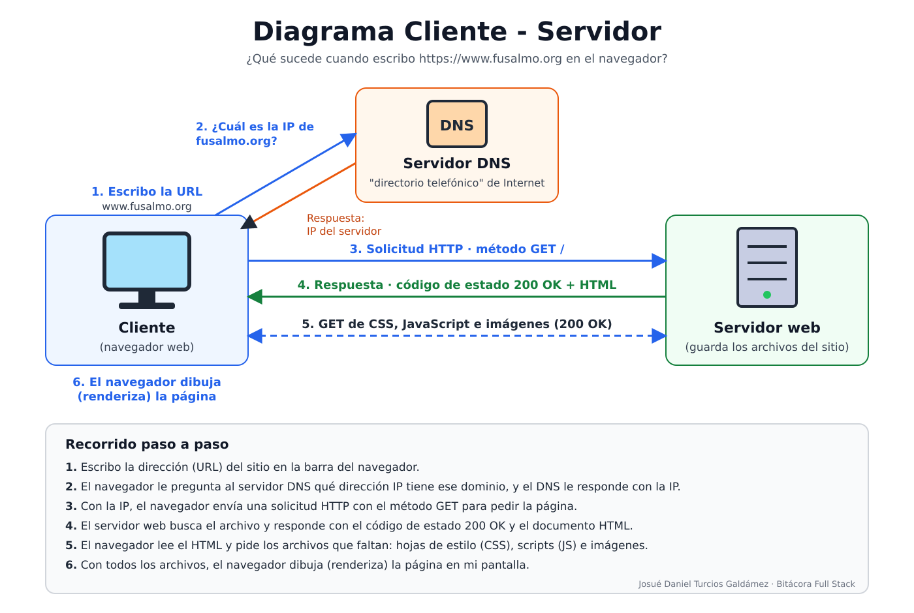

# Bitácora Full Stack – Josué Daniel Turcios Galdámez

Repositorio de evidencias del curso Desarrollo Web [Full Stack Junior].

---

## Datos del estudiante

| Campo               | Información                                  |
|---------------------|----------------------------------------------|
| **Nombre**          | Josué Daniel Turcios Galdámez                |
| **Usuario GitHub**  | [@72dxmxnn](https://github.com/72dxmxnn)     |
| **Curso**           | Desarrollo Web Full Stack Junior             |
| **Fecha de inicio** | 13 de noviembre                              |

---

## Objetivo del repositorio

Documentar, día a día, los temas vistos en clase, las prácticas realizadas y lo que aprendí, como evidencia de mi progreso en el curso.

---

## Tabla de contenido

- [Día 1 – 13 de noviembre: Fundamentos de la web](#día-1--13-de-noviembre-fundamentos-de-la-web)
  - [Esquema cliente-servidor](#esquema-cliente-servidor)
  - [Dominio, hosting y servidor](#dominio-hosting-y-servidor)
  - [Análisis con DevTools](#análisis-con-devtools)
  - [Reflexión sobre el uso de IA](#reflexión-sobre-el-uso-de-ia)

---

## Día 1 – 13 de noviembre: Fundamentos de la web

### Esquema cliente-servidor

### Dominio, hosting y servidor
| Criterio | Dominio | Hosting | Servidor |
|----------|---------|---------|----------|
| ¿Qué es? | ... | ... | ... |
| ¿Para qué sirve? | ... | ... | ... |
| ¿Tiene costo? ¿Cuánto aprox.? | ... | ... | ... |
| Ejemplo real | ... | ... | ... |

### Análisis con DevTools
- Sitio analizado: ...
- Número de solicitudes: ...
- Método y código de estado de la primera solicitud: ...
- Tres tipos de archivo recibidos: ...
- Tiempo de carga: ...
- Observación: ...

### Reflexión sobre el uso de IA
<!-- COMPLETAR: reflexión sobre el uso de IA -->

---

*Esta bitácora se actualiza al final de cada clase.*